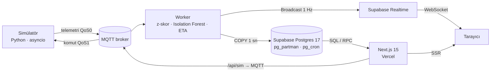

# SmartGrid Pulse

**Endüstriyel cihazların arızasını, eşiğe ulaşmadan dakikalar önce haber veren gerçek zamanlı
bakım paneli.**

> Demo GIF'i (normal filo → Motoru Isıt → uyarı → ETA → kritik → alarm) ekleniyor.

**Canlı demo:** https://smartgrid-pulse.vercel.app — üretimde simülatör çalışmadığı için
canlı akış yalnızca lokalde (`pnpm run up`) görülür; üretim paneli son kaydedilen durumu gösterir.

- 12 sanal cihaz (motor, rüzgâr türbini, pompa, trafo) saniyede bir sıcaklık, titreşim,
  basınç ve akım yayınlar; arızalar ani değil, dakikalar içinde büyüyen eğilimler olarak gelişir.
- Worker her cihaz için kayan z-skor, Isolation Forest ve eğilim analizini birleştirip
  0–100 sağlık skoru ve **kritik eşiğe kalan süre (ETA)** üretir.
- Panel Apple tasarım dilinde; canlı durum Supabase Realtime ile saniyede bir güncellenir,
  arıza komutları tarayıcıdan sunucu üzerinden MQTT'ye gider.

## Mimari



Veri akışı, topik sözleşmesi, şema, saklama politikaları ve güvenlik matrisi:
[docs/architecture.md](docs/architecture.md).

### Neden MQTT?

- **Cihaz dünyasının dili.** Sahadaki PLC'ler, gateway'ler ve sensörler MQTT konuşur; HTTP her
  okuma için bağlantı, başlık ve el sıkışma maliyeti demektir. MQTT'de bir telemetri mesajı ~200
  bayttır ve kalıcı tek bağlantı üzerinden gider.
- **Doğru teslim garantisi doğru yerde.** Telemetri QoS0 (bir okuma kaybolursa bir sonraki 1 sn
  sonra gelir), komutlar QoS1 (en az bir kez). Arıza haritası `retained`: yeniden bağlanan worker
  güncel durumu hemen alır.
- **Gevşek bağlılık.** Simülatör worker'ı, worker paneli bilmez; hepsi topik sözleşmesine bağlıdır
  (`smartgrid/{site}/{device}/telemetry`). Gerçek cihazlar simülatörün yerine kod değişmeden girebilir.
- **Tarayıcı broker'a bağlanmaz.** Canlı veri Realtime'dan gelir, komutlar Vercel fonksiyonundan
  gider; broker şifreleri hiçbir zaman istemci paketine girmez.

### Neden TimescaleDB yerine yerel bölümleme?

Supabase, TimescaleDB'yi yalnızca Postgres 15 projelerinde destekliyor; Postgres 17'de eklenti
kullanımdan kaldırıldı. Yeni bir projeyi eski sürüme bağlamak yerine aynı ihtiyaçlar Postgres'in
kendi araçlarıyla karşılandı:

| İhtiyaç | TimescaleDB | Burada |
|---|---|---|
| Zamana göre parçalama | hypertable chunk'ları | `PARTITION BY RANGE (time)` + pg_partman, günlük bölüm, 3 gün önceden |
| Saklama | `add_retention_policy` | pg_partman `retention`: süresi dolan bölüm `DROP` edilir (satır silme yok, vakum yok) |
| Uzun aralık sorguları | continuous aggregate | `telemetry_1m` + pg_cron her dakika son 5 dk'yı `INSERT … ON CONFLICT` ile tazeler |
| Gruplama | `time_bucket()` | `date_bin()` (Postgres 14+) |
| Sorgu budama | chunk exclusion | partition pruning (15 dk sorgusu yalnız bugünün bölümünü tarar) |

**Takaslar:** sıkıştırma yok (ham veri bu yüzden kısa tutulur), özet tablonun tazeliği 1 dakikalık
cron'a bağlı ve geç gelen veri yalnızca son 5 dakika için düzeltilir. Karşılığında eklenti
bağımlılığı yok, her Postgres 17'de aynı şema çalışır ve saklama ucuz bir `DROP TABLE`'dır.

## Anomali tespiti

Her cihaz için bir `DeviceMonitor` üç sinyali birleştirir.

**1. Kapılı kayan z-skor** (metrik başına 600 örnek, toplam ve kare toplamıyla O(1)):

$$z_t = \frac{x_t - \mu}{\max(\sigma,\ 0.002\,|\mu|)}, \qquad \bar z_t = 0.4\,z_t + 0.6\,\bar z_{t-1}$$

\|z\| > 4 olan örnek tabana **öğretilmez**, 300 örnek üst üste reddedilirse yeni rejim kabul edilir.
Yavaş bir rampa hiç \|z\| > 4 üretmeden tabanı genişletip kendini normal sayabildiği için
(simülasyonda σ 6'dan 16'ya çıktı, z ~2,3'te kaldı) pencere dolduktan sonra
\|z̄\| ≥ 2,5 iken de öğrenme durdurulur.

**2. Cihaz başına Isolation Forest** — [sıcaklık, titreşim, basınç, akım] standardize edilir; yalnız
normal örneklerle (\|z\| < 3 ve limit içinde) 180 örnekte eğitilir, her 600 yeni örnekte yenilenir.
Eşik sabit değildir: eğitim verisinin anomali skorlarından p50 ve p99,5 saklanır,

$$\text{IF} = \operatorname{clip}\!\left(\frac{s - p_{99.5}}{p_{99.5} - p_{50}},\ 0,\ 1\right)$$

Böylece düşük varyanslı trafolar normal çalışırken alarm vermez. Tek örnek puanlama için eğitilmiş
ağaçlar düz listelere derlenir: sklearn `score_samples` ile birebir aynı sonuç (fark < 1e-15),
~100× hızlı (3,9 ms → 0,035 ms).

**3. Eğilim ve kritik eşiğe kalan süre** — son 90 örneğe en küçük kareler eğimi $b$ ve $R^2$.
Yalnızca metrik zaten sapmışsa (\|z̄\| ≥ 2,5 veya uyarı bölgesi), taban olgunsa ve $R^2 ≥ 0{,}35$ ise:

$$\text{ETA} = \min\!\left(\frac{L_{\text{kritik}} - x}{b \cdot 60},\ 240\right)\ \text{dk}$$

(basınçta alt limit ve negatif eğim). Normal yük döngüsü sahte ETA üretmez.

**Sağlık skoru ve durum:**

$$H = 100 - \Big(P_{\text{limit}} + \min\big(6(\max|\bar z| - 3),\,30\big) + 30\cdot\text{IF} + \min\big(1{,}5(15-\text{ETA}),\,20\big)\Big)$$

$P_\text{limit}$ uyarı bölgesinde 25→60, kritikte 60. Skor düşerken α = 0,6, toparlanırken α = 0,08
ile yumuşatılır (alarm hızlı gelir, yavaş söner). Herhangi bir metrik kritikte veya H < 40 →
**kritik**; uyarıda veya H < 70 → **uyarı**. Durum yükselince Türkçe mesajlı alarm yazılır
(cihaz + seviye başına 60 sn bekleme).

## Ölçümler

Yerel Docker yığını, i7-13620H / 32 GB. Ayrıntılar, yöntem ve ham sayılar: [docs/benchmarks.md](docs/benchmarks.md).

| Ölçüm | Sonuç |
|---|---|
| Yük: 200 cihaz × 2 Hz, ~10 dk | 400 msg/s sürekli, **0 kayıp** satır |
| Ingest gecikmesi (cihaz `ts` → Postgres commit) | p50 **566 ms** · p95 **1,3 s** (1 sn'lik COPY partileri) |
| Worker kaynak kullanımı (400 msg/s) | CPU ort. %20 · p95 %34 (1 çekirdek = %100) · bellek ≤ 522 MiB |
| `get_device_history` p95 (3,56 M ham satır, 451 MB) | 15d 1,6 ms · 1s 2,4 ms · 6s 0,1 ms · 24s 0,9 ms · 7g 5,1 ms |
| Tespit (senaryo, 3 tohum) | normalde **0** yanlış alarm, **0** sahte ETA · motor overheat: uyarı 64–75 s, kritik 130–171 s, ETA önce |
| Canlı uçtan uca (tarayıcı, 1×) | uyarı 65 s · kritik 170 s · ETA 4 → 1 dk · alarm toast + `/alerts` |
| Isolation Forest tek örnek puanlama | 3,9 ms → **0,035 ms** (~100×) |
| Erişilebilirlik | Lighthouse **100**, axe WCAG 2.1 AA **0** ihlal |

Yük testinde bulunan sorun: 200 cihaz eğitim eşiğine aynı anda ulaşınca 188 model birden eğitildi
ve p95 gecikme 19 sn'ye çıktı. Eğitimler saniyede 2 ile sınırlandırıldı → p95 1,3 sn.


## Hızlı başlangıç (Docker)

Gerekenler: Node.js 22+, Docker Desktop. pnpm 12 (corepack bu sürümü henüz çalıştıramıyor):

```bash
npm install -g pnpm@12
pnpm install
pnpm run up
```

`pnpm run up` yerel Supabase'i başlatır, anahtarlarını okur ve broker, simülatör, worker ve paneli
Docker'da derleyip sağlıklı olana kadar bekler. Panel: http://localhost:3000
(3000 doluysa `DASHBOARD_PORT=3100 pnpm run up`). `pnpm up` (run'sız) pnpm'in kendi `update`
komutudur.

| Komut | Ne yapar |
|---|---|
| `pnpm run up` | Supabase + Docker Compose yığınını başlatır |
| `pnpm run down` | Compose'u ve Supabase'i durdurur (veri korunur) |
| `pnpm run reset-db` | Migration'ları ve seed'i baştan uygular |
| `pnpm run logs` | Servis loglarını (JSON) izler |

Yerel adresler: panel `/status` (gizli durum sayfası) · Supabase Studio http://127.0.0.1:54423 ·
giriş e-postaları (Mailpit) http://127.0.0.1:54424 · MQTT `localhost:1883` (WebSocket `9001`).
Giriş magic link iledir; ziyaretçi paneli salt okunur görür, simülasyon ve alarm onayı girişlidir.

## Testler

```bash
pnpm lint && pnpm test                                   # ruff, mypy, pytest · tsc, eslint
pnpm --filter @smartgrid/worker scenario                 # 12 cihaz, 900 s normal + 420 s arıza
pnpm --filter @smartgrid/dashboard test:ui               # 390/768/1440 px, açık/koyu, axe WCAG AA
E2E_BASE_URL=http://localhost:3000 pnpm --filter @smartgrid/dashboard test:e2e   # giriş → overheat → kritik → /alerts
DEVICE_COUNT=200 PUBLISH_HZ=2 bash scripts/loadtest.sh out/   # yük testi
```

## Geliştirme (Docker'sız)

```bash
pnpm supabase start
docker compose -f infra/docker-compose.yml up -d mosquitto
pnpm --filter @smartgrid/simulator dev
pnpm --filter @smartgrid/worker dev           # services/worker/.env.example → .env
pnpm --filter @smartgrid/dashboard dev        # apps/dashboard/.env.example → .env.local, :3100
```

Şema değişince tipleri yenileyin: `SUPABASE_DB_PASSWORD=postgres pnpm db:types`.
Yerel Supabase portları 544xx'tir (API `54421`, DB `54422`): 543xx başka projelerle,
55xxx Windows'un ayırdığı aralıkla çakışmasın diye.

## Üretim

| Parça | Nerede | Durum |
|---|---|---|
| Panel | Vercel (`apps/dashboard`, Git entegrasyonu) | https://smartgrid-pulse.vercel.app |
| Veritabanı, Auth, Realtime | Supabase (eu-central-1) | Migration'lar CI'da otomatik |
| MQTT broker | Kullanıcının seçimi (TLS 8883) | Repo hazır broker içermez |
| Simülatör + worker | Railway / Fly.io (Dockerfile, `/healthz`) | Yapılandırma hazır, dağıtılmadı |

- **Supabase:** `supabase link` → `supabase db push` → `supabase/scripts/production_settings.sql`
  (ham veri 1 gün; ücretsiz plan 500 MB, ham veri günde ~140 MB) →
  `supabase/scripts/verify_production.sql` (pg_partman, pg_cron, cron işleri, RLS) →
  `supabase config push` (`[remotes.production]`: site URL ve Vercel/preview yönlendirmeleri).
- **Broker:** EMQX Cloud, HiveMQ veya kendi Mosquitto'nuz (HiveMQ Cloud'un ücretsiz Serverless
  planı 30 Eylül 2026'da yeni kullanıcılara kapandı). İki kullanıcı: `device` (simülatör) ve
  `backend` (worker + `/api/sim`); yetkiler [`infra/mosquitto.acl.example`](infra/mosquitto.acl.example).
- **Railway:** iki servis, kök dizinler `services/simulator` ve `services/worker` (`railway.json`).
  Env: `MQTT_*`, worker için `DATABASE_URL` (Supavisor **session** pooler, 5432 — COPY transaction
  pooler'da çalışmaz), `SUPABASE_URL`, `SUPABASE_SERVICE_ROLE_KEY`. GitHub'da `RAILWAY_TOKEN` +
  `RAILWAY_ENABLED=true` → `deploy.yml` her push'ta dağıtır. Fly.io için `fly.toml` hazır.
- **Vercel:** root `apps/dashboard`; `NEXT_PUBLIC_SUPABASE_URL`, `NEXT_PUBLIC_SUPABASE_ANON_KEY`,
  sunucuya özel `MQTT_HOST/PORT/TLS/USERNAME/PASSWORD`. Panel service role key kullanmaz.

## CI / CD

| İş akışı | Ne zaman | Adımlar |
|---|---|---|
| `ci.yml` | Her PR ve `main` | ruff, mypy, pytest (senaryo testi dahil) · tsc, eslint, next build · 3 Docker imajı |
| `deploy.yml` | `main`, elle, her gün 06:00 | `supabase db push` + üretim ayarları + doğrulama · (Railway) · smoke test |

Smoke test (`scripts/smoke.mjs`): Realtime'dan 10 sn içinde `state`, yetkisiz `/api/sim` → 401,
`get_fleet_stats` → 12 cihaz.

## Yapı

| Klasör | İçerik |
|---|---|
| `apps/dashboard` | Next.js 15 App Router, TypeScript strict, Tailwind, Recharts, zustand, TanStack Query |
| `services/simulator` | Python 3.12, asyncio, aiomqtt, pydantic-settings, structlog |
| `services/worker` | Python 3.12, asyncpg, numpy, scikit-learn, httpx, structlog |
| `supabase/` | Migration'lar, seed, üretim script'leri |
| `infra/` | `docker-compose.yml`, `mosquitto.conf`, broker ACL örneği |
| `scripts/` | Yerel yığın, smoke test, yük testi, benchmark, demo |
| `docs/` | Mimari, ölçümler, portföy özeti |
| `prompts/` | Faz promptları ve ilerleme |
