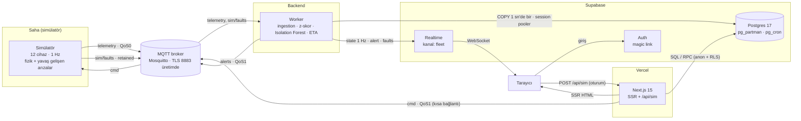

# Mimari

SmartGrid Pulse dört parçadan oluşur: sanal cihazları üreten **simülatör**, veriyi yazan ve
anomali arayan **worker**, verinin ve kimliğin tutulduğu **Supabase** ve tarayıcıdaki **panel**.
Aralarındaki tek sözleşme MQTT topikleri ve Supabase şemasıdır.

## Veri akışı

Tarayıcı broker'a hiç bağlanmaz: canlı durumu Realtime'dan okur, komutları sunucu üzerinden
gönderir. Broker şifreleri yalnızca simülatör, worker ve Vercel fonksiyonunda bulunur.

### Bir telemetri mesajının yolu

| Adım | Nerede | Süre (yerel ölçüm) |
|---|---|---|
| Cihaz okuması üretilir, `ts` damgalanır | simülatör | — |
| QoS0 publish → broker → worker | MQTT | < 5 ms |
| Doğrulama (pydantic), monitöre ve tampona ekleme | worker | < 1 ms |
| 1 sn'lik toplu `COPY` | Postgres | bkz. [benchmarks.md](benchmarks.md) |
| 1 Hz `state` yayını | Realtime → tarayıcı | ≤ 1 sn |

## MQTT topik sözleşmesi

| Topik | QoS | Yayıncı → Abone | İçerik |
|---|---|---|---|
| `smartgrid/{site}/{device_id}/telemetry` | 0 | simülatör → worker | `{device_id, name, type, site, ts, seq, temperature, vibration, pressure, current}` |
| `smartgrid/cmd/{device_id}/fault` | 1 | panel → simülatör | `{action: "inject" \| "clear", type?, intensity?}` |
| `smartgrid/cmd/all/reset` | 1 | panel → simülatör | boş |
| `smartgrid/sim/faults` | 1, retained | simülatör → worker | `{updated_at, faults: {device_id: {type: {intensity, since}}}}` |
| `smartgrid/alerts` | 1 | worker → herkes | worker'ın ürettiği alarm |

Birimler: sıcaklık °C, titreşim mm/s RMS, basınç bar, akım A, `ts` epoch milisaniye.
`{site}` saha adının slug'ıdır (`İzmir Şebeke TM-3` → `izmir-sebeke-tm-3`).
Komut topiklerinde `device_id` `^[a-z0-9-]{1,32}$` ile doğrulanır; `+`, `#` ve `/` enjekte edilemez.

## Realtime olayları (kanal `fleet`, Broadcast)

| Olay | Sıklık | İçerik |
|---|---|---|
| `state` | 1 Hz | `{ts, devices: DeviceState[], faults}` — değerler, z-skorlar, bölgeler, sağlık, durum, IF skoru, ETA, neden, limitler |
| `alert` | durum yükseldiğinde | `{id, ts, device_id, device_name, severity, metric, value, zscore, message}` |
| `faults` | arıza haritası değişince | `{faults}` |

Tüm olaylar tarayıcıda zod ile doğrulanır; şemalar `apps/dashboard/lib/types.ts` içindedir ve
worker'ın `DeviceState.to_payload()` çıktısıyla birebir eşleşir.

## Şema

| Nesne | Tür | Açıklama |
|---|---|---|
| `devices` | tablo | `device_id` PK, ad, tip, saha, `first_seen`, `last_seen` |
| `telemetry` | **günlük bölümlü** tablo | ham 1 Hz veri; PK yok (append-only, COPY); `(device_id, time desc)` + `time` BRIN |
| `telemetry_1m` | tablo | dakikalık özet: avg/max (basınçta min), `samples`; PK `(device_id, bucket)` |
| `device_health` | **günlük bölümlü** tablo | 5 sn'de bir sağlık skoru, durum, IF skoru, max\|z\|, ETA |
| `alerts` | tablo | alarm kayıtları; `acknowledged`, `acknowledged_by` (auth.users) |
| `device_latest` | view (`security_invoker`) | her cihaz + son `device_health` satırı |
| `get_device_history(device, range)` | RPC | 15m/1h ham veriden 5/15 sn kova; 6h/24h/7d özetten 1/5/30 dk kova |
| `get_health_history(device, hours)` | RPC | 5 dk'lık sağlık kovaları |
| `get_fleet_stats()` | RPC | cihaz sayısı, mesaj/sn, açık alarm, tahmini satır, tablo boyutları |
| `get_system_status()` | RPC | veri tazeliği, bölümler, cron durumu (`/status` sayfası) |

Gruplama TimescaleDB'nin `time_bucket()` yerine yerleşik `date_bin()` ile yapılır.

## Saklama ve zamanlanmış işler

| Veri | Saklama | Mekanizma |
|---|---|---|
| `telemetry` (ham) | 3 gün lokal · **1 gün üretim** | pg_partman `retention`, bölüm `DROP` |
| `telemetry_1m` | 90 gün | günlük pg_cron `DELETE` (03:15 UTC) |
| `device_health` | 30 gün | pg_partman `retention` |
| `alerts` | süresiz | — |

| pg_cron işi | Takvim | Ne yapar |
|---|---|---|
| `partman-maintenance` | saat başı | yarının bölümlerini açar (`premake = 3`), süresi dolanları düşürür |
| `refresh-telemetry-1m` | her dakika | son 5 dakikayı `date_bin` ile gruplar, `INSERT … ON CONFLICT DO UPDATE` |
| `telemetry-1m-retention` | her gün 03:15 | 90 günden eski özetleri siler |

Üretimdeki 1 günlük ham saklama `supabase/scripts/production_settings.sql` ile uygulanır
(ücretsiz plan 500 MB; ham veri günde ~140 MB).

## Güvenlik

| Rol | `devices`, `telemetry_1m`, `device_health`, `alerts`, view, RPC | `telemetry` (ham) | Yazma |
|---|---|---|---|
| `anon` (ziyaretçi) | SELECT | yok (yalnız RPC üzerinden) | yok |
| `authenticated` | SELECT | yok | `alerts.acknowledged`, `acknowledged_by = auth.uid()` |
| `service_role` (worker) | tümü | tümü | tümü |

- Supabase'in `public` şemasındaki yeni tablolara anon/authenticated'a otomatik yetki vermesi
  kapatıldı; pg_partman'ın sonradan açtığı bölüm tabloları API'de hiç görünmez.
- Panel service role key kullanmaz. `NEXT_PUBLIC_*` yalnızca URL ve anon key'dir.
- `/api/sim`: oturum zorunlu (yoksa 401), zod doğrulama, kullanıcı başına dakikada 20 komut,
  broker'a her istekte kısa ömürlü bağlantı.

## Anomali motoru

Ayrıntılar ve formüller: [README → Anomali tespiti](../README.md#anomali-tespiti).
