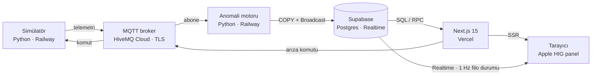

# SmartGrid Pulse — Fazlı prompt seti

SmartGrid Pulse 8 fazda kurulur. Her faz dosyası, Claude Code'a verilecek promptu ve
"bitti" kontrol listesini içerir. Kullanım:

1. Bu klasörde terminal aç → `claude`
2. İlk mesaj: `CLAUDE.md'yi oku ve Faz 0'ı uygula (prompts/faz-0-iskelet.md)`
3. Her faz bitince: `Faz 1'i uygula` … `Faz 7'yi uygula`
4. İlerleme: `prompts/PROGRESS.md`

| Faz | Dosya | Konu |
|---|---|---|
| 0 | `faz-0-iskelet.md` | Monorepo iskeleti, CLAUDE.md |
| 1 | `faz-1-supabase-sema.md` | Supabase şeması, partitioning, rollup, RLS |
| 2 | `faz-2-mqtt-simulator.md` | MQTT broker + sanal IoT simülatörü |
| 3 | `faz-3-worker-anomali.md` | Ingestion + anomali motoru |
| 4 | `faz-4-tasarim-sistemi.md` | Apple HIG tasarım sistemi + dashboard iskeleti |
| 5 | `faz-5-canli-veri.md` | Canlı veri, simülasyon paneli, alarmlar |
| 6 | `faz-6-docker-deploy.md` | Docker Compose + Vercel/Supabase/Railway deploy |
| 7 | `faz-7-test-portfoy.md` | Test, gözlemlenebilirlik, README/portföy |

## Mimari

Tarayıcı broker'a hiç bağlanmaz: canlı durumu Realtime'dan okur, arıza komutlarını
Vercel sunucusu MQTT'ye yazar.

## Vercel + Supabase'in mimariye etkisi

- **TimescaleDB yerine yerel bölümleme.** Supabase'de TimescaleDB yalnızca Postgres 15
  projelerinde destekleniyor, Postgres 17'de kullanımdan kaldırıldı
  ([kaynak](https://supabase.com/docs/guides/database/extensions/timescaledb)). Yeni projeler
  için `pg_partman` + `pg_cron` ile günlük bölümler, saklama süresi ve 1 dakikalık özet
  tablosu kurulur; `time_bucket()` yerine `date_bin()`
  ([geçiş rehberi](https://supabase.com/docs/guides/database/migrating-to-pg-partman)).
- **MQTT broker ve Python servisleri Vercel dışında çalışır.** Vercel serverless olduğu
  için kalıcı MQTT bağlantısı tutamaz. Broker: HiveMQ Cloud (veya EMQX Cloud);
  simülatör ve worker: Railway (veya Fly.io).
- **Canlı veri tarayıcıya Supabase Realtime Broadcast ile gelir.** Worker saniyede bir
  filo özetini yayınlar; tarayıcı broker şifrelerini hiç görmez.
